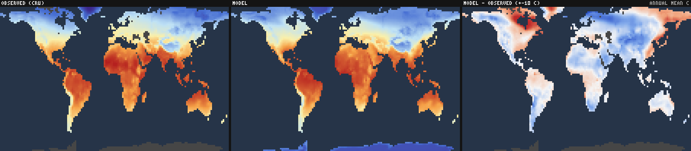
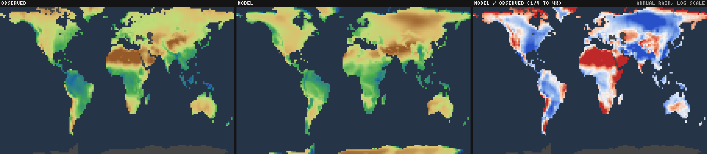
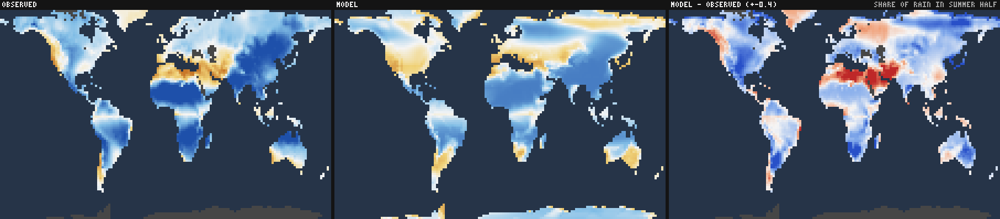
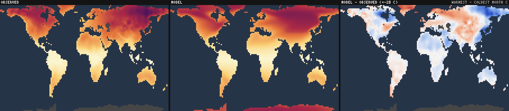
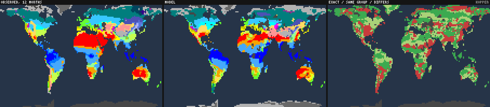

# The climate model on the real Earth

Written 2026-11-25. A test of the climate part of `js/planetgen.js` (temperature, seasons, rain,
Köppen) on Earth's real relief, scored against observed climate. Nothing in the climate was
changed; this is the measurement only.

## How it works

- `node tools/earth-fetch.js` downloads Earth's relief and observed climate and averages them
  onto the generator's 150 × 95 grid (75°S–75°N). It writes `tools/earth/earth-150x95.json`
  (committed, so the test runs offline). Raw downloads are cached in `tools/out/earth-raw`.
- `node tools/earth-climate.js` hands that relief to the generator in place of its own terrain
  (`AEON.planetgen.terrainIn`, a few lines in planetgen.js that normal worlds never touch). It
  runs the climate exactly as for a generated world, for 5 seeds (the seed only moves the weather
  noise), and compares every land cell with the observations. It takes about 3 s. Output goes to
  `tools/out/earth/` (summary.txt, metrics.json, maps).

Because the terrain is Earth's own, whatever comes out wrong is the climate model's fault, not the
terrain's.

**Data.**
- Relief: ETOPO1 (NOAA), sampled every 15′.
- Observed climate: CRU CL 2.0 (New et al. 2002), the 1961–1990 station normals on a 10′ land
  grid. It gives monthly temperature and rain; 3,871 land cells hold enough points to compare.
- Sea surface temperature (ERSST) is wired in but was not downloaded: NOAA's ERDDAP server kept
  dropping that dataset. Run the fetch again later to add it.

**Köppen.**
- The observed Köppen class uses the standard rules on 12 months (Peel et al. 2007, with Köppen's
  −3 °C between C and D, as the model uses).
- The model classifies from a shortcut: the annual mean, the seasonal range and the summer share
  of rain. So the observed climate is also put through that same shortcut. Comparing the two
  separates the classifier's error from the climate's.

**Yardstick.** Each cell also gets the observed mean climate of its own latitude row: latitude
alone, with no continents, coasts or mountains. A model that knows geography should beat this.
The yardstick has an unfair edge, because it was fitted to Earth itself. For example, it "knows"
the Sahara's row is dry. Still, a physical model should at least match it.

## Results

Area-weighted over land. The median of 5 seeds; the spread between seeds is small (shown in
summary.txt).

| | Model | Yardstick (latitude only) |
|---|---|---|
| Annual mean temperature: bias / RMSE | −3.0 / 4.9 °C | 0 / 4.2 °C |
| Seasonal range (warmest − coldest month): bias / RMSE | −1.4 / 5.1 °C | 0 / 5.6 °C |
| Annual rain: correlation (log) | 0.49 | 0.53 |
| Annual rain: land within a factor of 2 | 53% (22% too wet, 25% too dry) | 67% |
| Summer share of rain: correlation | 0.45 | 0.44 |
| Köppen: same group / first two letters / exact | 61 / 34 / 26% | 66 / 40 / 34% |
| Köppen via the shortcut, on observed data | 97 / 89 / 87% | |

**In short:**
- Temperature and the seasonal range are good in pattern (r 0.96 and 0.93), but too cold.
- Rain and Köppen do not beat latitude alone. The model's geography does not yet add skill to
  rain.
- The classifier is not the problem: on observed data it gets 87% of land exactly right. The
  error comes from the climate.

Köppen groups, % of land, observed → model: A 22 → 21, B 30 → 30, C 16 → 18, **D 26 → 15,
E 6 → 18**. The totals look right for A, B and C, but they are often in the wrong places (see the
group map).

*Each sheet: observed, model, difference. On the Köppen sheet, dark green is exact, light green
the same group, red a different group. Grey land has no CRU data. The maps show the model at
GEN_VERSION 6 (see Progress); the numbers in this section are from before the refit.*

## What is wrong, in order of how much it costs

1. **The subtropical deserts get rain.** The Sahara and Arabia get 4× or more of their
   observed rain (Cairo 242 mm, observed 42), and their rain falls in summer. The western US and
   Australia's interior are also too wet. On Earth the descending air of the Hadley cell keeps
   these dry all year. The model's monsoon shift seems to pull the tropical rain belt over the
   whole of North Africa in July. It also feeds the interior from recycled rain.
2. **Mid-latitude interiors are far too dry.** North America east of the Rockies, Europe east
   of the Baltic, and China get under half their observed rain (Chicago 142 mm, observed 859;
   Moscow 320, observed 652; Beijing 153, observed 529). The westerlies dry out on the way
   inland, and nothing brings moisture from the south. On Earth that moisture comes from the
   Gulf of Mexico, the summer monsoon of East Asia, and the cyclones of the storm tracks. As a
   result, Dfa/Dfb climates become steppe or desert.
3. **The monsoons of South Asia are weak.** Mumbai gets 742 mm against 2,137, and Kolkata 394
   against 1,602. The summer share is right, but the amount is not: the land–sea pressure
   drive is too weak. East Africa is the opposite: Nairobi gets 5,697 mm against 722.
4. **Everything is too cold, worst at 15–45° N** (−5 to −6 °C: Cairo, Madrid, Beijing, Perth,
   Mumbai). The cell heights agree with CRU's to ±30 m, so this is not a height mismatch. Likely
   causes:
   - The sea-level curve `T0` is fitted to Earth's zonal means, which mix land and sea. In the
     subtropics land is warmer than the zonal mean.
   - The continentality term (−0.06 × (1 − marine) × sin(lat)) cools interiors in the annual
     mean, but on Earth interiors differ mostly in range, not in mean.
   This shifts D to E: much of the observed D ends up in the model's E (9% of land: Siberia and
   Canada read as tundra).
5. **The dry-summer belt runs straight across the continents.** The model puts a
   Mediterranean-like summer drought at 35–45° from Spain to Mongolia and across the US
   Midwest. On Earth that pattern belongs to west coasts only (California, the Mediterranean,
   Chile, the Cape, south-west Australia). East coasts and interiors get most of their rain in
   summer.
6. **The range in Siberia is too small** (Yakutsk 39 °C against 60). The interior
   winter is not cold enough, because no cold high forms over a big continent.

What is already right: the temperature pattern, the range by latitude, wet tropics and
the Amazon, the Mediterranean of Europe in winter, west-coast oceanic climates (London Cfb),
and the share of each Köppen group overall.

## How to use it

- Run `node tools/earth-climate.js` before and after any climate change. A fix is real when it
  improves this score and the generated worlds' numbers (`tools/worldgen-report.js`) together.
- Targets to aim for: temperature bias within ±1 °C and RMSE under 3.5 °C; rain within a factor
  of 2 on 70%+ of land; Köppen group agreement above 75%. That is clearly better than latitude
  alone.
- Careful: tuning only to Earth can overfit. The constants should stay physical, so other
  worlds keep behaving.

## Progress

### Climate refit (2026-11-25, GEN_VERSION 5; changes every seed's climate, biomes and history)

Each change is physical and holds for any planet. Its size was fitted on Earth's land
(regressions of the test's errors against height, distance from the sea, dryness and latitude).

- **Lapse rate 6 → 4.9 °C/km.** The ground temperature of high land falls more slowly than
  free air (a plateau is a raised heat source). The error was −1.2 °C per km of height.
- **Inland annual mean:** +2.4 °C at the equator to −1.2 °C at 60° away from the sea's
  influence. The old term only cooled.
- **Dry ground runs hot:** up to +4.2 °C × cos(latitude) where the year's rain is near nil,
  none from 1,000 mm. This explained most of the subtropical cold bias.
- **Coastal seasonal range** about doubled (0.75 + 11.3·s instead of 1 + 6·s): a coastal
  cell is about 200 km of land, not the shore itself.
- **Weather noise on temperature** cut from ±6 °C to about ±3.5 °C. It was the largest source of
  seed-to-seed error.
- **Rain belts:** the tropical rain belt is narrower, and the subtropical sinking air keeps
  the deserts dry all year (Sahara, Arabia). The old belt reached 25° with a third of the
  equator's rain-out.
- **Pressure-driven winds (new):** each season, ground warmer than its latitude's mean
  (taken as at sea level) makes a low, and colder ground makes a high. The wind turns round
  them (Coriolis) and drifts across into the lows (friction), and lows rain more than highs.
  This replaces the old land–sea monsoon term, which only worked below 30°. It gives the Asian
  monsoon, Beijing's dry winter and wet summer, and wet east coasts.
- **Stable air off cold currents** rains less (the Atacama, the Namib). Air off warm
  currents rains more.
- **Orographic rain** factor 3.5 → 2 (East Africa got 4–8× its rain).
- **Air-mass capacity:** the water the air can hold follows half the ground's season and half
  its year. Sea air over a winter continent now carries snow inland instead of dropping it all
  on the first cold coast.
- **Rain in mm** refitted by quantile matching on Earth (2675 × (p / 0.097)^0.887).

Earth test, 10 seeds, median:

| | Before | After | Latitude only |
|---|---|---|---|
| Temperature bias / RMSE | −3.0 / 4.9 °C | **+0.2 / 3.0 °C** | 0 / 4.2 °C |
| Seasonal range RMSE | 5.1 °C | 4.8 °C | 5.6 °C |
| Rain correlation (log) | 0.49 | 0.53 | 0.53 |
| Rain within a factor of 2 | 53% | 60% | 67% |
| Köppen group / 2 letters / exact | 61 / 34 / 26% | **70 / 39 / 34%** | 66 / 40 / 34% |
| Summer share of rain: bias / r | +0.04 / 0.45 | +0.11 / 0.36 | 0 / 0.44 |

Temperature and the Köppen groups now beat latitude alone. Rain is closer but does not yet.
Places: Cairo gets 97 mm (was 242, observed 42), Beijing is Dwa (observed Dwa), and the
deserts are dry. The seasonality of rain got worse: summer rain is too strong almost
everywhere. Tried and rejected: storms that grow in winter with the season's pole-to-equator
contrast. They fixed the summer share partly but cost 4–5 points of Köppen group agreement.

### Realism suite (`node tools/realism-suite.js`)

It runs 100 new worlds (seeds 20001–20100, about 70 s) and measures 35 variables on each:
terrain, temperature and rain by latitude band, aridity, west and east coasts, Köppen groups
and two sub-types. It measures the same on Earth, and on the model run on Earth's relief. Earth
is one draw from all possible planets, so the test is whether it falls inside the worlds'
2.5–97.5% range. The model-on-Earth value separates the model's error from differences in
geography. The bell curves are in [realism-suite.html](worldgen/realism-suite.html) and the
table in [realism-suite.txt](worldgen/realism-suite.txt).

Result: Earth falls inside the range on **30 of 35** variables. Outside:
- **Summer share of rain** (worlds 0.81, Earth 0.64; the model on Earth gives 0.76) and
  **dry-winter climates Cw + Dw** (21%, Earth 8%; the model on Earth 17%). These are the
  model's error, the next thing to fix.
- **Rain at 45–60°** (912 mm, Earth 599) and **west-coast rain** (1,466 mm, Earth 895). The
  model on Earth gets 609 and 954 mm, so this is geography: generated worlds have narrower
  high-latitude land with mountain coasts.
- **Shelf share of the ocean** (9.6%, Earth 4.7% on this grid). Earth's shelves average away
  into the slope at 270 km cells, and the generator's do not: its shelves are too wide.

### Rain seasons (2026-11-25, GEN_VERSION 6)

- **The summer share was measured on the wrong months.** The model runs two seasons, July and
  January, which are the year's extreme months. Its share was July over July + January, while
  Köppen and the observations use the six summer months. For rain that follows a sine through
  the year, the summer half holds 0.5 + (2/π) × (the peak month's share − 0.5). The model now
  reports that. This alone removed the bias (+0.11 → +0.01).
- **Thermal highs and lows are shallow.** They steer the tropics (the monsoons), but from 25 to
  50° the moving storms of the westerlies outweigh them, so their winds now taper to a fifth.
  Before, the winter continent's high blew the air offshore at Seattle, so the Pacific's
  winter rain never came in.
- **The westerlies are seasonal:** 40% stronger in winter, when the pole-to-equator contrast
  is largest, and 40% weaker in summer (30–70°).

| Earth test, 10 seeds | Before | After | Latitude only |
|---|---|---|---|
| Summer share of rain: bias / RMSE / r | +0.11 / 0.28 / 0.36 | −0.03 / 0.19 / **0.47** | 0 / – / 0.44 |
| Köppen group / 2 letters / exact | 70 / 39 / 34% | 68 / **47 / 40%** | 66 / 40 / 34% |
| Rain within a factor of 2 | 60% | 58% | 67% |

The seasonality of rain now beats latitude alone. The cost is 1.5 points of Köppen groups:
the stronger winter westerlies leave the interiors a little drier (more B). Moscow is Dfc
instead of Dwc, and Seattle's summer share went from 0.83 to 0.56 (observed 0.26).

Suite (same 100 seeds): Earth is inside on **32 of 35**. The summer share matches (0.64 against
0.64), and the dry-winter climates (4.8%, Earth 8%) and the rain at 45–60° are now in range.
Still outside: the shelves; west-coast rain (1,308 mm, Earth 895); and, newly, Mediterranean
climates, which are too rare (1.5%, Earth 3.5%; the model on Earth 1.7%).

### The red flags of the suite (2026-11-25, still GEN_VERSION 6)

**Mediterranean climates.** On the cells that Earth has as Cs, the model's summer share was
right (+0.05), so the dry summers were not the problem. The problem was that these places were
3 °C too cold (they became D) and got half their rain (they became B). Three changes:
- **A cold sea's chill reaches the land at half.** Air off a cold current is stable, so its
  chill stays in a shallow layer by the coast. Air off warm water mixes and carries its warmth
  inland in full, as at London. West coasts by a cold sea had been 3.2 °C too cold.
- **A winter continent's high counts a quarter.** It is a shallow dome of cold air, and the
  storms and the sea air pass over it. The summer heat lows of the monsoons count in full.
  Before, the winter highs of Australia and Iberia blew the sea air away from Perth and
  Portugal.
- **Winter fronts rain through stable air.** In the winter storm belt the cold current's
  damping of rain is half lifted.

Of Earth's Cs land, the model now calls 37% Cs, up from 20%. Over the 100 worlds Cs is 2.7%
(Earth 3.5%).

**Shelves.** Every piece of continental crust below the sea was shelf, 40–220 m deep. But a
cell is about 270 km and a shelf averages about 80 km, so the cell at the ocean's edge also
holds the shelf break and the slope, and averages deeper. That edge ring is now up to 1,500 m
deeper, unless the noise keeps a wide shelf there (Siberia, Sunda, Patagonia). The shelf share
falls from 9.6% to 6.8% of the ocean. That is near Earth's true share, about 7.5%. Earth reads
4.7% on this grid because its narrow shelves average away into the slope.

**West coasts (left on purpose).** The worlds' west coasts get 1,423 mm and Earth's get 895,
but the model on Earth's own map gives 905. So the physics is right. The generated worlds just
have warmer water off their west coasts (+2.3 °C against Earth's −0.9 °C), because their
oceans are shaped differently. Pushing this towards Earth would make the worlds copy Earth.

| Earth test, 10 seeds | GEN 5 | Rain seasons | Now | Latitude only |
|---|---|---|---|---|
| Temperature bias / RMSE | +0.2 / 3.0 °C | +0.3 / 3.1 °C | +0.4 / 3.0 °C | 0 / 4.2 °C |
| Rain within a factor of 2 | 60% | 58% | 60% | 67% |
| Summer share r | 0.36 | 0.47 | **0.55** | 0.44 |
| Köppen group / 2 letters / exact | 70 / 39 / 34% | 68 / 47 / 40% | **70 / 49 / 41%** | 66 / 40 / 34% |

Suite: Earth is inside the worlds' range on **34 of 35** variables. Only the west coasts are
outside.

### The heat budget (2026-11-26, GEN_VERSION 7)

Temperature and the seasons now come from a seasonal energy balance: sunlight by latitude and
day from the planet's tilt, snow and sea ice, and the air carrying heat poleward. They no longer
come from tables fitted to Earth. See [ENERGY_BALANCE.md](ENERGY_BALANCE.md). Earth test,
10 seeds: Köppen **73 / 52 / 43%** (was 70 / 49 / 41%), temperature error 3.0 °C (unchanged),
seasonal range error 5.0 °C (was 4.8). Suite: Earth is inside on 32 of 35. The worlds' land is
about 1 °C colder than Earth's because of their higher terrain, and dry-winter climates are short.

### Winds from the heat (2026-11-26, GEN_VERSION 9)

The wind belts now come from each world's heat budget: the tropical rain belt lies where the air
is warmest (pulled a little towards each continent's summer heat), the Hadley cell's width scales
with the equator-to-pole contrast, rotation and size, and the westerlies' strength and seasons
follow the 30–60° temperature contrast. See [WINDS.md](WINDS.md). Earth test, 10 seeds: Köppen
**73.3 / 51.1 / 43.4%** (was 73.1 / 51.9 / 43.2%), temperature error 3.1 °C, range error 4.9 °C.
Suite: Earth is inside on **34 of 35** (was 32); dry-winter climates and the land at 15–30° are
back inside. Only the west-coast rain is outside.

### The currents' heat (2026-11-26, GEN_VERSION 10)

The heat the currents carry is now a heat source on each sea cell in the heat budget, spread over
about 10° of latitude, and the air carries less where the sea carries more (Bjerknes
compensation). See [OCEAN_HEAT.md](OCEAN_HEAT.md). Earth test, 10 seeds: Köppen **72.7 / 50.3 /
43.0%** (was 73.3 / 51.1 / 43.4%), temperature bias −0.3 °C and error 3.1 °C, mean land rain
740 mm (was 694, observed 794). Land at 0–15°N is now 25.8 °C (observed 25.7) and at 60–75°N
−8.7 °C (observed −8.9). Suite: 34 of 35, as before.
