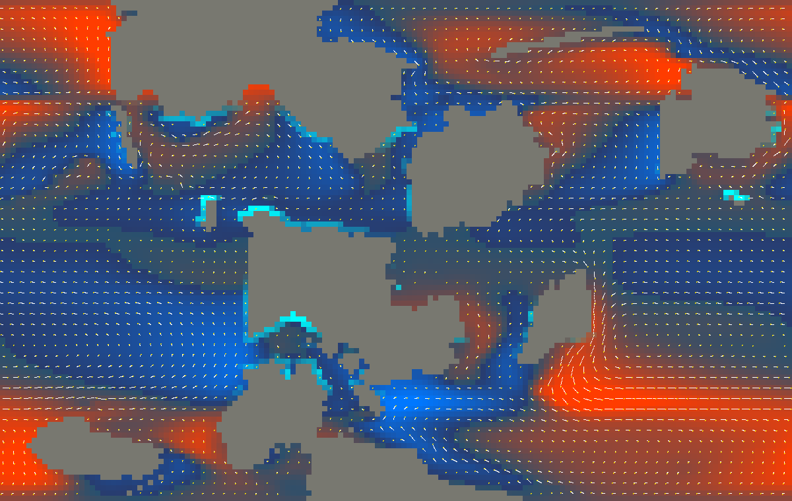

# Ocean currents: design

2026-11-23. Built and tuned. Code in `js/planetgen.js` (`oceanCurrents`, and the sea temperature
block after `winds(0, ...)`), drawing in `js/pixelmap.js`, check in `tools/currents-report.js`.

## In short

**What changed.** Every world now has its own ocean currents. They follow from that world's
winds, coastlines and sea floor, so two seeds with different continents get different gyres,
warm currents and cold upwelling. The currents set the sea's temperature. Through the winds the
sea temperature reaches the land, and through the land's temperature, the rain and the biomes.

**What it replaced.** Before, a sea cell's warmth came from a fixed rule. It looked for land east
and west along its own row and applied a set offset by latitude band. Heat did not travel, any
land counted (even a small island), and the world's winds and sea floor played no part. The map
drew a second, separate current field guessed from the wind.

**What regions get.** Nothing new is needed. A region already copies the planet's temperature,
seasons and rain, so the currents reach it through those. The map draws the planet's currents on
a region too, steered along the region's finer coasts.

**How much it changes a world.** Per seed, 4-9% of land cells change biome, mostly on coasts.
Biome shares over many seeds stay within 2 points of before (forest moves most, -1.7; see the
tuning record). Land temperatures by latitude band stay within about 0.5 °C on average.
Generation takes no longer.

 Every seed's history changes (habitability follows
the biomes), so watched chapters and changes kept in the browser for a seed are dropped once
(`AEON.GEN_VERSION`, now 2).

## The model

**1. The circulation** (`oceanCurrents`). Stommel's model of the wind-driven ocean, solved for a
stream function over the sea:

    r lap(psi) + beta d(psi)/dx - k psi = curl(wind)

- `curl(wind)` is the spin the annual-mean winds give the water. The trades and westerlies
  together turn the subtropical oceans clockwise in the north and anticlockwise in the south;
  the westerlies and polar easterlies turn the subpolar oceans the other way. The winds are
  blurred over two cells first, so their noise bends the gyres without speckling them.
- `beta` is how fast the Coriolis effect grows northward (`CUR_BETA` times cos latitude). It
  squeezes each gyre's return flow into a narrow fast current on the basin's western side
  (like the Gulf Stream and Kuroshio), and spreads the rest slow and wide.
- `k` is drag from a shallow sea floor (`CUR_SHELF`, from the depth in metres, `Hm`). Shelves
  and shallow straits carry little, so a strait or a ridge can cut one basin off from another.
- `psi` is 0 on every coast and on the map's top and bottom rows, so water flows along shores,
  never into them. Islands are coasts too.

It is solved by over-relaxation (about 300 sweeps). The current is the stream function's slope,
scaled so 90% of the sea moves at speed 1 or less, and capped at 2.5.

Checked over seeds 1, 7, 42 and 99: 98-100% of sea cells at 15-40° next to a western shore of
a basin flow poleward, and 95-100% next to an eastern shore flow equatorward, as on Earth.

**2. Coastal upwelling.** The Ekman drift is the wind turned 90° (right in the north, left in the
south). Where it points away from the coast, cold water rises. It counts at full strength from
12° to 35° latitude, fades by 4° and 45°, and reaches up to 3 cells out. This gives the cold
coasts that Earth has off California, Peru, Namibia and Morocco, wherever this world's winds
blow along a coast the right way.

**3. The sea's temperature.** A steady state of 160 steps. Each step, a sea cell takes the water
from upstream on the current (`CUR_DT` cells at full speed), mixes a little with its neighbours
(`CUR_MIX`), and gives part of its anomaly to the air (`CUR_XCHG`). Upwelling sets a colder
level to fall back to (up to `CUR_UP` °C). So fast currents carry tropical warmth far poleward,
and currents from high latitudes carry cold toward the equator.

Two corrections keep the world's climate calibrated:
- The base temperature curve (`T0`) is fitted to Earth's zonal means, which already include the
  ocean's poleward heat transport. So each row's mean anomaly is removed, and the currents only
  decide where along a latitude the water is warm or cold.
- The open sea's own zonal level is added back (`CUR_ZONAL`). At high latitudes the sea is
  warmer than the air's zonal mean, because it keeps the summer's warmth through the winter.
  This table was calibrated so that land temperatures by latitude band match the old model.

The resulting anomaly (`sstA`) goes into the existing steps unchanged: carried inland on the wind
(`marine`, `anom`), deciding which seas freeze, and setting how much moisture the sea air holds.

## Tuning record

Compared with the old model on 10 seeds (historical pack), mean biome share of land, old -> new:

| Version | tundra | taiga | forest | grassland | desert | jungle | land 45-60° |
|---|---|---|---|---|---|---|---|
| Heat carried, no zonal correction | 14.0 -> 15.9 | 10.8 -> 10.7 | 15.5 -> 14.8 | 11.4 -> 12.2 | 16.5 -> 16.5 | 9.5 -> 8.1 | -1.5 °C |
| Zonal mean removed | 14.0 -> 15.8 | 10.8 -> 10.4 | 15.5 -> 13.6 | 11.4 -> 11.8 | 16.5 -> 16.2 | 9.5 -> 9.4 | -1.5 °C |
| Plus `CUR_ZONAL` (final) | 14.0 -> 14.4 | 10.8 -> 11.1 | 15.5 -> 15.0 | 11.4 -> 11.7 | 16.5 -> 16.1 | 9.5 -> 9.2 | -0.3 °C |

The final version in `tools/worldgen-report.js` (18 seeds, both packs), median share of
ice-free land, before -> after: desert 20.6 -> 20.6, jungle 10.3 -> 10.3, savanna 12.4 -> 12.3,
forest 17.5 -> 15.8, grassland 11.3 -> 11.3, taiga 9.5 -> 9.2, tundra 8.3 -> 9.2, mountain
5.7 -> 5.6, swamp 0.5 -> 0.5, ice 3.1 -> 3.0.

- The first version moved heat poleward on top of a curve already fitted to that transport:
  tropics 1-2.5 °C too cold, the 60-75° sea up to 5 °C too warm.
- A stronger gain (1.8) did not help the high latitudes. Land there sits downwind of colder water
  under the polar easterlies, and more contrast made that worse.

## What it does not do

- **Seasons.** The currents come from the annual-mean winds. Monsoon reversals of the currents
  (as in the Indian Ocean) are not modelled.
- **A circumpolar current.** The map's top and bottom rows are walls, so a current all the way
  around the world (like the Antarctic one) has no net flow.
- **Deep water.** The circulation driven by salt and temperature works over centuries and barely
  shows at this map's scale.
- **Spin.** Every world spins the way Earth does. A spin setting per seed would mirror the winds
  and `beta`.
