# World generation: a realism review

Written 2026-10-24. A review of `js/planetgen.js` (dispatched by `js/worldgen.js`) as an Earth
scientist would read it, assuming an Earth-like planet: Earth's size, atmosphere, water volume,
rotation, axial tilt and magnetic field, no other celestial effects. This is step 1: a report
only. Nothing in the generator was changed.

## How it was measured

`node tools/worldgen-report.js` runs `AEON.createWorld` (terrain only, never `AEON.runAll`) for
18 seeds (1, 2, 3, 7, 11, 42, 99, 123, 256, 512, 777, 1000, 1234, 2024, 4242, 31337, 65536,
99999) in both packs. It measures every layer in `world._gen`, compares each with rough Earth
figures, and writes `tools/out/` (gitignored): `summary.txt`, `metrics.json`, a sheet of nine
layers per seed (`seed-<n>.png`), an overview of all seeds (`overview-*.png`) and zonal charts
(`chart-*.png`). The run takes about 40 s. A few of the images are copied into `docs/worldgen/`.

- **The packs share the terrain.** For every seed the elevation and biome of every cell are
  identical in historical and fantasy. The generator reads the pack only for habitability.
  That is good for the planned shared package: terrain is pack-free already.
- **Units.** The generator has none. Elevation is 0..1 with the sea at 0.5 and the highest land
  cell always 1; temperature, rain and moisture are 0..1. Where this report gives metres, it
  assumes the highest cell is 5,000 m (a cell is about 47,000 km², so that is a Tibet-like
  average, not a peak) and the deepest is -7,000 m. Where it gives °C, it uses a fit of the
  generator's sea-level temperature against Earth's zonal means: **°C = -22.4 + 55.6 × T**. The
  fit is good to about 1.5 °C at every latitude, so the conversion is fair.
- **Earth figures** are rounded textbook values (WWF/Olson biome areas, standard hypsographic
  curve, zonal climatologies), good to a few percent. They are in the harness (`EARTH`).
- **Areas** are weighted by cos(latitude): a cell at 60° covers half the ground of one at the
  equator. Percentages below are of area, not of cells.

Numbers are given as the median over the 18 seeds, with the range in brackets.

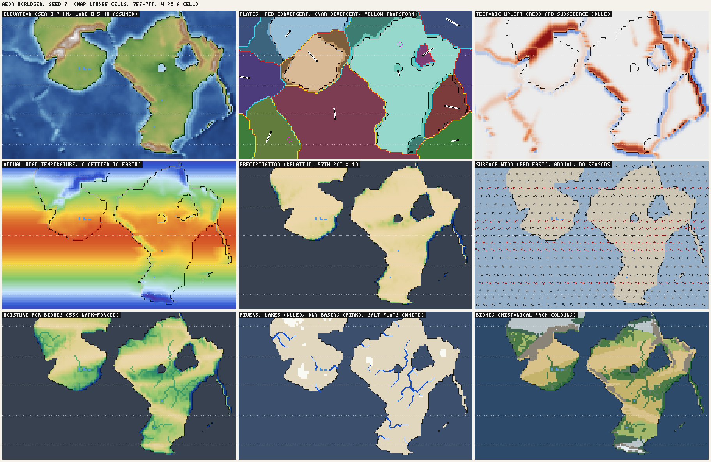

*Seed 7. Top: elevation, plates (red convergent, cyan divergent, yellow transform; arrows show
plate motion), uplift. Middle: temperature, precipitation, wind. Bottom: the moisture the biome
classifier uses, rivers / lakes / dry basins, biomes. Dotted lines at the equator and 30° and
60°.*

## Headline findings

1. **Rain stops at the coast.** The mean precipitation 0-1 cells from the sea is 0.39 (35-60°
   latitude, relative units), 0.13 at 2-3 cells, 0.03 at 4-6 cells and 0.00 beyond 17. On Earth
   rain in the westerlies decays over 1,000-2,000 km (5-10 cells); here it is gone in about 2
   cells (~400 km). **84% (76-88%) of all land gets less than a tenth of the wet coasts' rain**:
   the physical model makes nearly every continental interior a desert.
2. **The biome map hides this by forcing moisture to its rank.** The classifier's moisture is
   55% rank and 45% rain, so every world gets the same spread of wet and dry land whatever its
   climate. Interior biomes are therefore decided by tiny differences in near-zero rain, plus
   river corridors and noise, not by climate. The desert share (23%) looks Earth-like only
   because the rank forces it to.
3. **The tropical biomes start at 12 °C.** In °C the classifier's cut-offs are: ice < -16.8,
   tundra < -10.2, taiga < 1.5, temperate < 12.1, tropical ≥ 12.1, jungle > 14.3. Whittaker's
   tropical biomes need about 20 °C. Result: savanna 23% of land (Earth ~15%), 13% of it poleward
   of 30°; 31% of all savanna and jungle sits below 20 °C. Jungle is only 6% (Earth ~14%),
   because wet interiors (point 1) do not exist.
4. **No seasons.** Everything is an annual mean. Monsoons, the ITCZ swinging north and south,
   Mediterranean dry summers, continental winters and the wet-dry savanna cannot exist. These
   decide a third of Köppen's climate types.
5. **Elevation has no vertical scale, and mountains are a quantile.** Land is stretched so the
   highest cell is always 1, and "mountain" is the top 10% of land (at least 0.66). A world
   without a big collision gets plateau continents (median land 1.5-2.1 km in six seeds under
   the 5 km assumption) and mountains made of noise: in 8 of 18 seeds a quarter to two thirds of
   the mountain biome lies where tectonics raised nothing.
6. **The plate tectonics are the strongest part.** Plate counts, sizes, the boundary mix (about
   a third each convergent, divergent, transform) and the link between mountains and convergent
   margins (a median 89% of mountain area lies within 1,000 km of one) are
   Earth-like.

## Layer by layer

### Grid and projection

- 150 × 95 cells over 360° × 150° (75°S-75°N): a cell is 2.4° × 1.58°, about 267 × 176 km at
  the equator and 134 × 176 km at 60°.
- **Not realistic:** every process treats a cell as the same size: plate growth, blurs, the
  inland reach of uplift, distance from the coast, wind advection (one cell per step), erosion.
  At 60° a plate, a mountain belt or a rain shadow is physically half as wide east-west as the
  same feature at the equator, and winds move half as fast in km. Noise is sampled on a
  cylinder, which has the same distortion. The equal-angle map is fine for display; the physics
  needs `cos(latitude)` in its east-west distances (or a sphere mesh).
- The poles (beyond 75°) are absent. That is a design choice (Daan rejected polar caps), but it
  means no Antarctica-like or Arctic-ocean climate driver exists.

### Plate tectonics

| | Model | Earth |
|---|---|---|
| Plates | 11 (9-14) | 7 major + 8 minor (> 1%), 50+ microplates |
| Largest plate | 24% (16-36%) | Pacific ~20% |
| Seven largest | 87% (79-99%) | ~90% |
| Continental crust | 40% (32-44%) | ~41% |
| Boundaries: convergent / divergent / transform | 30 / 35 / 34% | about a third each |
| Collision (continent-continent) boundary | 2,900 km (0-15,400) | Alpine-Himalayan belt ~10,000 km |

Realistic:
- Plate sizes are uneven and the count is right for the resolution; microplates would be under
  a cell anyway.
- Boundary interactions follow the crust on each side: collision ranges, Andean margins with a
  trench offshore, island arcs on the lighter of two oceanic plates, rifts, ridges. Passive
  margins (continent edge inside a plate) get no relief, as on the Atlantic coasts.
- Hotspot chains trail behind plate motion.

Not realistic:
- Plates translate; they do not rotate about Euler poles. On a sphere the convergence rate and
  type change along one boundary; here they change only with the boundary's orientation.
  Acceptable at this resolution.
- One continental core per continental plate, grown inside it: a continent can never span a
  plate boundary (no sutured continents like Eurasia or India-Asia) and continents are rounded
  blobs (see the overview). Coastal cells are 13% (8-17%) of land.
- Relief is purely present-day: no old, eroded orogens inside continents (Urals, Appalachians),
  no cratons versus sedimentary basins, no plateau behind a collision (Tibet, Altiplano), no
  foreland basins. Interior relief is fbm noise.
- Transform boundaries produce nothing (fine: on Earth they make little relief at this scale).

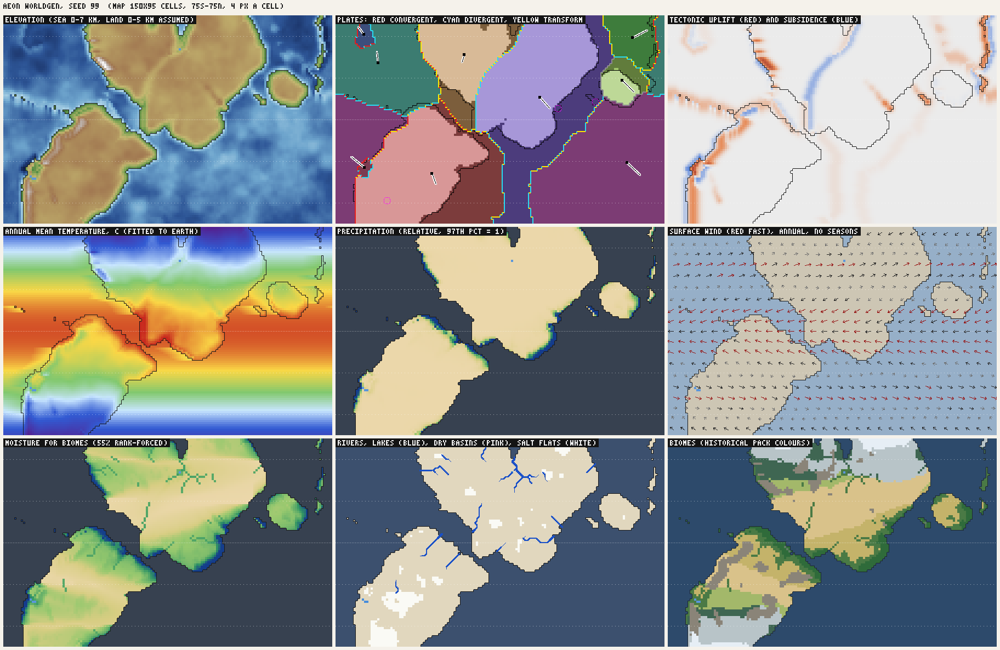

*Seed 99: almost no convergent margin touches land, so the continents are high plateaus, the
mountain biome is noise (64% of it has no tectonic uplift), and the rain still stops at the
coast.*

### Continents, land share, islands, seas

| | Model | Earth |
|---|---|---|
| Land share of the surface | 40% (30-46%) | 29% |
| Largest landmass, share of land | 67% (32-96%) | Afro-Eurasia 57% |
| Landmasses ≥ 5% of land | 3 (1-6) | 4-5 |
| Land on oceanic crust (arcs, hotspots) | 5% (1-17%) | small |
| Continental crust under the sea | 3% (0-22%) | ~29% |

- **Too much land.** Sea level is the 58-70% quantile of cells, independent of the crust, so 16 of
  18 seeds have more than 33% land, and continental crust is almost never submerged.
- **Shelves are missing.** Earth's continental shelves (0-200 m) are 7.5% of the ocean floor; here
  1.3% (0.9-3.1%). Elevation blends crust over a 2-cell blur and then the sea level cuts it
  wherever the quantile falls, so coasts sit on a smooth ramp: the sea is 1,160 m deep one cell
  offshore and 2,460 m two cells out. There is no shelf break and no continental slope (see the
  hypsography chart). Marginal seas on shelves (North Sea, Yellow Sea, Sunda) and shelf islands
  (British Isles, Sri Lanka) cannot form.
- **Enclosed water below sea level is treated as open sea.** 17 of 18 seeds have water bodies below
  sea level cut off from the world ocean (median 52 cells, up to 788 in seed 256; 72 cells a seed
  on average even when diagonal links count). Some are real marginal seas the grid closed; others are inland depressions.
  Either way they get sea temperatures, act as an unlimited moisture source and have no water
  balance. On Earth an enclosed basin is a lake (Caspian), a dry depression (Qattara, Dead Sea) or
  connected through a strait.
- Island arcs and hotspot chains exist; continental islands and archipelagos on shelves do not.

### Mountains

| | Model | Earth |
|---|---|---|
| Mountain biome, share of land | 10% (6-12%) | high mountains ~10%, montane biomes ~4% |
| Mountain area within 500 / 1,000 km of a convergent boundary | 46 / 89% | nearly all young ranges |
| Mountain area with no tectonic uplift | 3% (0-64%) | |
| Longest range | 6,000 km (4,600-7,700) | Andes 7,000, Rockies 4,800 |

- Where tectonics build mountains, they are in the right places: along Andean margins and
  collisions, with realistic lengths and widths (collision belts ~4.5 cells, Andean ~2.6).
- The mountain line is a quantile, so every world has about 10% mountains whether or not its
  plates collide; when they do not, noise highs fill the quota (seeds 1, 3, 11, 99, 2024, 4242,
  31337, 65536).
- Only 32% (19-74%) of land within 300 km of a convergent boundary is high (top 20% of the
  land range): weak convergence makes little relief, which is right, but a coast-parallel range
  should still be continuous along an active margin.

### Elevation and hypsometry

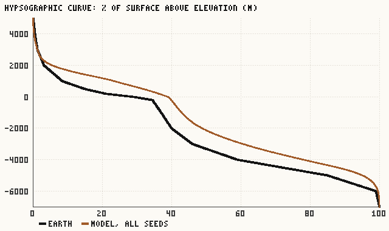

- Land median 1,210 m (440-2,120) and 90th percentile 2,060 m under the 5 km assumption. Earth's
  median land is about 450 m. Because land is stretched to the highest cell, the whole height
  distribution moves with one peak: a world with one big orogen has low plains, a world without
  one has plateaus. Land below 200 m (Earth: about a quarter of the land: Amazonia, the West
  Siberian and North European plains) is rare.
- Ocean median -3.6 km (Earth -4.0); deeper than 4 km 36% of the ocean (Earth ~58%). The sea
  floor has no age-depth relation: Earth's floor deepens with the square root of its age, from
  ~2.5 km at the ridges to ~5.5 km on old floor; here the abyss is noise around ridges of tiny
  amplitude. That is also why the elevation map shows little structure at sea (which Daan noted).
- Erosion carves valleys (3 passes of stream power) but deposits nothing: no alluvial plains,
  coastal plains or deltas.

### Temperature

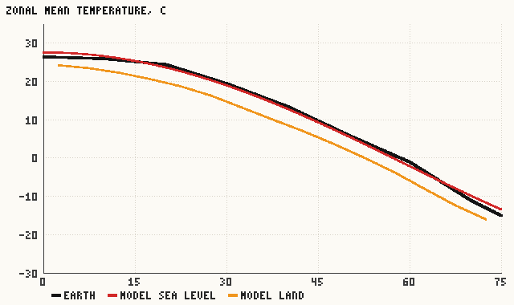

Realistic:
- The sea-level profile with latitude matches Earth within 1.5 °C everywhere (27.7 °C at the
  equator, 19 °C at 30°, -2 °C at 60°, -13 °C at 75°).
- Continental interiors are colder than coasts at the same latitude: -4.5 °C (-7.8 to -2.0) at
  45-60°. Plausible for annual means (Earth: -5 to -10 °C).
- The signs of the coastal current effects are right: subtropical west coasts are cooler
  (16.9 °C) than east coasts (19.1 °C); subpolar west coasts warmer (2.0 °C) than east coasts
  (0.7 °C).

Not realistic:
- **Lapse rate too weak.** Cooling is 0.34 × h^1.3 of the normalised height: 19 °C at the
  highest cell, 4 °C at 1,500 m (Earth: 6.5 °C/km, so 9.8 °C at 1,500 m and 32 °C at 5,000 m).
  Plateaus are too warm; mountain biome cells average 10 °C (up to 15 °C in some seeds). Because
  heights are relative, the cooling also changes from world to world.
- **Current effects are far too weak and only one cell deep.** Subpolar west coasts are 1.4 °C
  warmer than east coasts; on Earth Bergen is about 12 °C warmer than the Labrador coast at the
  same latitude. The anomaly is only applied to cells touching the sea; it is not carried inland
  by the westerlies.
- Low-frequency noise adds up to ±6 °C of warm and cold tongues tied to nothing physical.

### Winds and circulation

- The three-cell zonal pattern is correct in direction and latitude: easterly trades turning
  equatorward, westerlies at 30-60° turning poleward, polar easterlies (see the wind panel).
- Missing: pressure systems (subtropical highs centred over the oceans, the Icelandic and
  Aleutian lows), land-sea monsoon circulation, the seasonal shift of all belts (~5-15°), jet
  streams and storm tracks as moisture carriers. The rain factor table (wet equator, dry 25°,
  wet 45-58°) stands in for them, as a function of latitude alone.

### Ocean currents

- Present: cold water off subtropical west coasts (12-40°) and warm drift off subpolar west
  coasts (42-66°), detected as "land within 8 cells to the east". Right idea, right sign.
- Missing: the gyres themselves, warm western boundary currents (Gulf Stream, Kuroshio) that
  make subtropical east coasts warm and wet, cold subpolar currents on east coasts (Labrador,
  Oyashio), equatorial upwelling, a circumpolar current, and sea ice.

### Precipitation, rain shadows, droughts

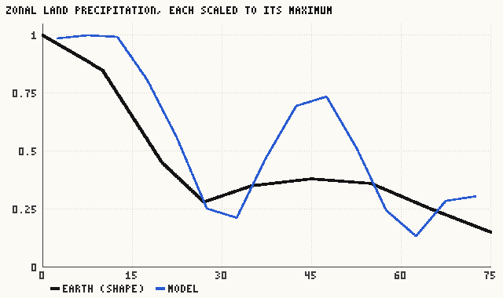

- The zonal shape is right: wet equator, a dry belt at 25-35°, a second maximum at 40-50°, dry
  poles. The model's mid-latitude peak (0.7 of the equator) is too strong compared with Earth
  (~0.4) and its 60-65° minimum too deep.
- Coast asymmetries have the right signs: at 10-35° east coasts (0.49) are wetter than west
  coasts (0.10); at 40-60° west coasts (0.60) are wetter than east coasts (0.03). But the 40-60°
  contrast is extreme: Earth's east coasts there (New England, Japan, Korea) get 1,000-1,500 mm
  from passing cyclones. Here they are desert.
- Rain shadows exist and are very strong: land beside mountains gets 22× (4-84×) more rain on the
  windward side than on the lee. Earth's strongest shadows are 5-10×.
- **Why the interiors are dry** (finding 1). Moisture is carried by advection over land only and
  lost at every cell by a fixed fraction (0.045 × the latitude factor) plus 9.5 × any rise in
  ground height. Any uphill step, including noise bumps of a few hundred metres and the step from
  the sea floor up to the coast, removes 10-80% of the moisture; going downhill never gives it
  back; and plants return only a third of a cell's rain. A test (scratch, not committed) on six
  seeds: making the sea count as sea level for the rise term changed little (land with P < 0.1:
  85% → 82%); lowering the rise factor from 9.5 to 2 brought it to 64%; both, 61%. The decay is
  still far too fast, so the fix needs moisture recycling (evapotranspiration, which supplies
  about half of the rain over continental interiors on Earth) and orographic lift computed on
  smoothed terrain, not one parameter.
- Drought as an event or a variable (interannual variability) does not exist; "dry" is only a
  place.

### Rivers, lakes and basins

| | Model | Earth |
|---|---|---|
| Endorheic land (drains to no sea) | 22% (10-41%) | ~18% |
| Largest catchment, share of land | 5.9% (4-17%) | Amazon 4.7% |
| Catchments over 1% of land | 14 (11-21) | about 12-14 |
| Lakes, share of land | 0.1% (0-0.6%) | ~1.8% |
| River cells crossing desert | 0% | Nile, Indus, Colorado, Tigris-Euphrates |

Realistic:
- The drainage tree (priority flood) always drains; basin sizes and the endorheic share are
  Earth-like; dry basins absorb what flows in and get salt flats.

Not realistic:
- Lakes are far too rare. Only depressions with a positive water balance become lakes, and the
  depression threshold is coarse; there are no rift lakes (rifts sink below sea level and become
  "sea"), few glacial lake districts, and no terminal lakes (a closed basin with inflow close to
  evaporation should hold a lake smaller than the basin, like the Caspian, Aral or Chad).
- River cells are always the top 6.5% by flow, whatever the climate, so a dry world has as many
  rivers as a wet one.
- Rivers never cross deserts: the river bonus to moisture turns their cells into grassland or
  savanna. At 267 km a cell, the Nile valley is a desert cell with a river in it.
- No deltas, estuaries or floodplains.

### Biomes

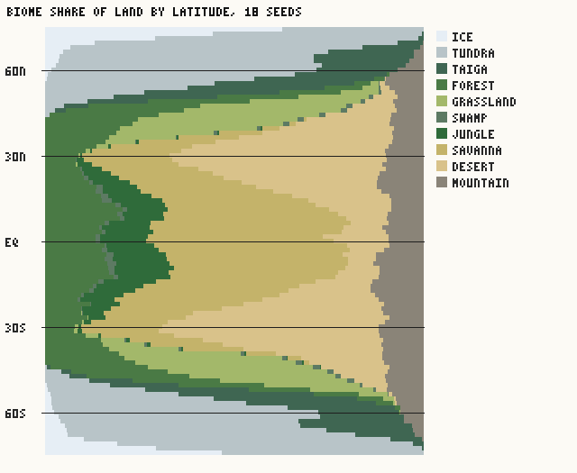

| Biome | Model (% of ice-free land) | Earth (approx.) | Model mean °C | Whittaker, roughly |
|---|---|---|---|---|
| desert | 23 (16-31) | 20 | 16 | hot 20-30; cold -5-15 |
| savanna | 23 (18-30) | 15 | 21 | 20-30 |
| forest (temperate) | 13 (11-18) | 16 | 17 | 5-20 |
| mountain | 10 (6-12) | 4 | 10 | (altitude, not a climate) |
| tundra | 10 (6-14) | 7 | -7 | -15 to -5 |
| grassland | 8 (3-12) | 8 | 7 | 0-20 |
| jungle | 6 (3-7) | 14 | 24 | 20-30 |
| taiga | 5 (2-7) | 12 | -3 | -5 to 5 |
| ice | 0.8 (0.3-2.9) | 2 | -18 | |
| swamp | 0.5 (0-3) | 1 | 21 | |

- The latitude bands are in the right order and deserts concentrate where they should (67% of
  desert area at 15-35°).
- Tropical cut-offs too cold (finding 3); savanna reaches 35-40°.
- Taiga is half Earth's share and never equatorward of 45°: cold land with moisture under 0.28
  is called tundra, and moisture is low everywhere inland. Cold dry steppe (Mongolia, Patagonia)
  thus becomes "tundra". The taiga/temperate line at 1.5 °C is close to Earth (~3 °C), the
  tundra/taiga line at -10 °C too cold (Earth ~-5 °C).
- "Mountain" is a height band, not a climate: on Earth the slopes of a tropical range are cloud
  forest and the top is alpine tundra; the treeline falls from ~4,000 m in the tropics to sea
  level at ~70°.
- Swamps need flat, wet, low ground next to a river or coast: reasonable.
- No Mediterranean, monsoon forest, temperate rainforest or cold steppe: these need seasons or
  absolute precipitation.

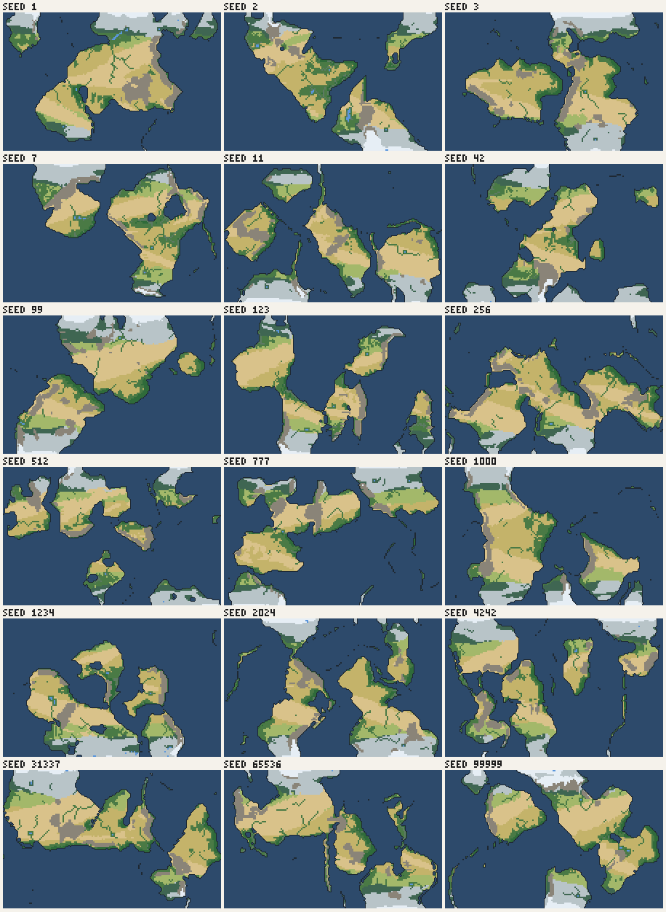

*Every seed shows the same pattern: green coasts, desert and savanna interiors, mountains as grey
patches, ice and tundra at the map edges.*

## Missing entirely

- Seasons: summer and winter climates, the ITCZ and monsoons, temperature range, Köppen classes.
- Physical units: metres, °C, mm a year.
- Moisture recycling over land (evapotranspiration).
- Ocean gyres and western boundary currents; sea ice.
- Storm tracks and tropical cyclones as rain sources.
- Continental shelves and slopes; sea-floor depth from age.
- Old orogens, cratons, plateaus, sedimentary basins and foreland basins.
- Deltas, floodplains, alluvial and coastal plains (deposition).
- Terminal and rift lakes; proper treatment of enclosed basins below sea level.
- Glaciers and ice caps from snowfall, not from temperature alone.
- Altitude zonation of vegetation (treeline, alpine).
- A latitude-correct metric (east-west distances shrink with cos(latitude)).

## Prioritised plan

Sizes: **S** a few hours, **M** about a day, **L** several days. "Terrain" means elevation, land
and sea; "climate and biomes" means temperature, rain, rivers, lakes and biomes on unchanged
land. **Every item changes every seed's history** (the history engine reads biomes, habitability,
rivers and coasts), so each one changes every world Daan has seen. Each step would be verified
with this harness, before and after renders, as agreed.

| # | Fix | Why | Size | Changes |
|---|---|---|---|---|
| 1 | **Inland rain.** Orographic lift on smoothed terrain with the sea as sea level, descent drying but not stripping; evapotranspiration returns rain to the air in proportion to how wet the ground is; storm-track mixing at 35-60° so east coasts get rain. Target: decay over 5-10 cells in the westerlies, P < 0.1 on 25-35% of land, windward/leeward ratio 3-8. | Finding 1: most land is physically desert | M | climate and biomes |
| 2 | **Drop the rank forcing** of moisture and of the river threshold; classify on absolute rain (mm a year) and absolute flow. | Finding 2; only meaningful after 1 | S | climate and biomes |
| 3 | **Biomes in °C and mm (Whittaker).** Tropical from ~20 °C, tundra/taiga at about -5 °C; cold dry land becomes steppe (grassland), not tundra; deserts hot or cold. | Finding 3 | S | biomes |
| 4 | **A vertical scale in metres.** Stop stretching land to the highest cell; uplift amplitudes in metres; lapse rate 6.5 °C/km; mountains from tectonics, not a quantile; an altitude zone (treeline by latitude) instead of a single "mountain" biome. | Finding 5; plateaus too warm | M | terrain, climate and biomes |
| 5 | **Sea level and shelves from the crust.** Sea level so that land is ~29-33%, most continental crust dry but ~25% of it shelf at -50 to -200 m with a sharp slope; ocean depth from distance to the ridges (age-depth). | Too much land, no shelves, flat ocean floor | M | terrain |
| 6 | **Ocean gyres.** Western boundary warm currents, eastern boundary cold, subpolar currents; carry the sea's temperature inland with the wind as moisture is carried. Sea ice for the map. | Coast climates too weak; warm wet east coasts missing | M | climate and biomes |
| 7 | **Seasons.** Two seasons (solstices): temperature with tilt and continentality, the ITCZ and the wind belts shifted, land-sea monsoon pressure; then Köppen-style classes (Mediterranean, monsoon, savanna as wet-dry, continental). | Finding 4; also gives seasonal maps for rendering | L | climate and biomes |
| 8 | **Lakes and basins.** Terminal lakes sized by water balance; enclosed basins below sea level become lakes or dry depressions unless they reach the ocean; rift lakes; more glacial lakes; rivers allowed through deserts. | Lakes 0.1% vs 1.8%; fake inland seas | M | terrain edge cases, hydrology, biomes |
| 9 | **Continental geology.** Old sutures and eroded orogens inside continents, plateaus behind collisions, sedimentary lowlands; deposition for floodplains and deltas. | Interior relief is noise; no lowlands | M-L | terrain |
| 10 | **Metric grid.** cos(latitude) in east-west distances for plate growth, blurs, spreading, winds and erosion (or a sphere mesh, L). | High-latitude features too narrow | M | terrain |

Suggested order: 1 → 2 → 3 first (they fix most of what the biome map shows, without touching
elevation), then 4 and 5 together (both rework the height scale), then 6, 8, 7, 9, 10. Items
1-3 could also be one combined step if Daan prefers fewer history-changing commits.

## Progress

### Fix 1, inland rain (2026-10-26, changes every seed's climate, biomes, rivers and history)

`planetgen.js` moisture transport: lift is read from the ground smoothed over one cell with the
sea at sea level (factor 3.5, was 9.5 on raw ground); land hands back 0-65% of its rain as
evapotranspiration (less in the cold; was a third of the loss times temperature); at 35-60°
moisture mixes 45% with the neighbouring cells, as cyclones carry it from every side (6% in the
tropics); sea air starts at 85% of the saturation it can hold over land of the same temperature
(it started above it, so every onshore coast dumped its excess in one cell). Terrain and
temperature are unchanged. 18 seeds, medians, before -> after:

| | Before | After |
|---|---|---|
| Land with P < 0.1 | 84% | 50% (36-69%) |
| Mean P 0-1 / 4-6 / 11-16 cells inland, 0-15° | 0.51 / 0.07 / 0.03 | 0.63 / 0.43 / 0.27 |
| Mean P 0-1 / 4-6 / 11-16 cells inland, 35-60° | 0.39 / 0.03 / 0.01 | 0.32 / 0.13 / 0.07 |
| Windward / leeward ratio | 22 | 2.8 (1.8-5.2) |
| East coasts 40-60° (west coasts) | 0.03 (0.60) | 0.13 (0.55) |
| Jungle / savanna / desert / forest | 6 / 23 / 23 / 13% | 15 / 16 / 20 / 17% |
| Jungle poleward of 23.5° | 11% | 2.5% |
| Lakes, share of land | 0.1% | 0.5% |
| River cells, share of land | 2.2% | 4.1% |

The interiors of the mid-latitudes still dry out faster than on Earth: the continents rise
inland (the missing vertical scale, fix 4) and the moisture is still rank-forced (fix 2).
Savanna poleward of 30° rose from 13% to 29% of all savanna: the tropical cut-off at 12 °C
(fix 3) now meets wetter subtropical land.

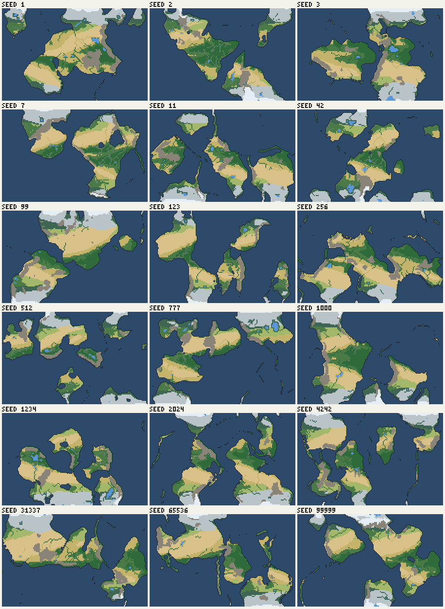

### Fix 2, no more rank forcing (2026-10-26, changes every seed's biomes, rivers and history)

Rain is divided by one fixed reference for every world (0.097, the median of each world's
wettest-3% level over the 18 seeds; it was each world's own 97th percentile). Biome moisture is
rain plus the river and lake bonuses raised to the power 0.47, no longer 55% rank: the power
spreads the skewed rain so the classifier's cut-offs fall where a typical world had them, so
its thresholds are unchanged. Rivers are cells with accumulated runoff of 0.96 or more on that
scale (was the top 6.5% of each world's land). Calibration: for each old cut-off, the raw
moisture at the rank where the blended value crossed it, median over 18 seeds.

| 18 seeds | Fix 1 median (range) | Fix 2 median (range) |
|---|---|---|
| Desert | 20% (11-27) | 18% (7-33) |
| Jungle | 15% (8-20) | 13% (5-20) |
| Forest | 17% (13-19) | 17% (9-24) |
| River cells | 4.1% (3.1-5.5) | 4.5% (2.4-6.0) |

The medians hardly move; the spread between worlds widens, as it should: seed 99 (high, dry
plateaus) has 33% desert, seed 512 (small, wet continents) 7%.

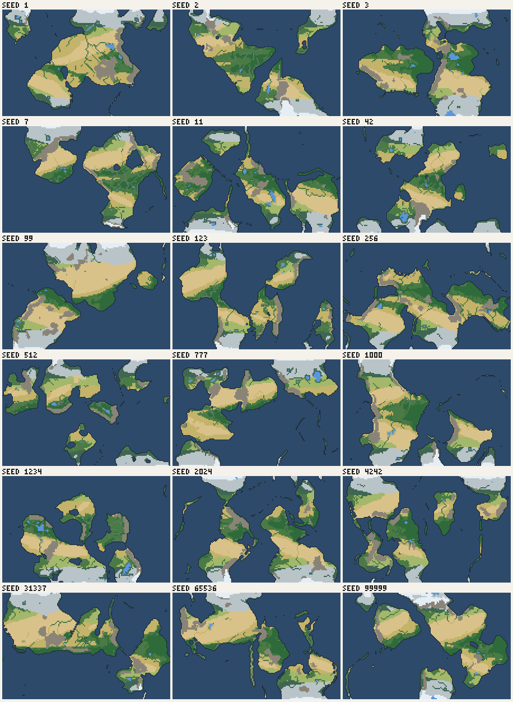

### Fix 3, biomes in °C and mm (2026-10-26, changes every seed's biomes, habitability and history)

The classifier now works in physical units. Temperature: °C = -22.4 + 55.6 × T (the fit to
Earth's zonal means). Rain: mm = 2680 × (rain / 0.097)^0.635, fitted so the 18 seeds' pooled
land rain matches Earth's spread (quartiles 241 / 608 / 1,173 mm against Earth's ~250 / 580 /
1,100; land mean 819 mm against ~800). Regions carry `tempC` and `rainMm`.

| Biome | Rule |
|---|---|
| mountain / ice | above the mountain line (unchanged); ice below -14.5 °C |
| ice | below -17 °C |
| tundra | -17 to -8 °C; or -8 to -2 °C with under 300 mm |
| grassland (cold steppe) | -2 to 3 °C with under 300 mm |
| taiga | -8 to 3 °C (swamp if flat, by water and over 500 mm) |
| desert | over 3 °C and under 10 × °C + 70 mm (Köppen's arid line, 5 × (2T + 14)) |
| grassland | 3-20 °C, under 25 × °C + 150 mm |
| forest | 3-20 °C, wetter (swamp if flat, by water and over 1,000 mm) |
| savanna | from 20 °C, under 1,300 mm |
| forest (seasonal tropical) | from 20 °C, 1,300-1,500 mm |
| jungle | from 20 °C, 1,500 mm or more (swamp if flat and by water) |

Rivers no longer turn desert green (a desert river cell stays desert, as the Nile valley is at
this scale), but such a floodplain gets +0.3 habitability and +0.25 food over other river cells,
so river valleys in deserts stay cradles of civilisation.

| 18 seeds, median (range) | Fix 2 | Fix 3 | Earth |
|---|---|---|---|
| Desert | 18% | 16% (4-30) | 20% |
| Savanna | 16% | 15% (8-22) | 15% |
| Jungle | 13% | 11% (3-14) | 14% |
| Forest | 17% | 21% (13-28) | 16% |
| Grassland | 7% | 11% (6-14) | 8% |
| Taiga | 5% | 8% (4-12) | 12% |
| Tundra | 11% | 8% (3-12) | 7% |
| Savanna poleward of 30° | 27% of savanna | 0.2% | ~0 |
| Jungle poleward of 23.5° | 2.4% of jungle | 0.7% | small |
| Mean °C of savanna / jungle / taiga / tundra | 19 / 24 / -2.5 / -7.5 | 23 / 24 / -1.3 / -9.7 | 20-30 / 20-30 / -5-5 / -15 to -5 |
| River cells in desert | 0% | 7% | Nile, Indus, Tigris |

Jungle is still a little short and forest a little long: the tropical land is not as wet as
Earth's, and the map has more mid-latitude land than Earth (land share, fix 5).

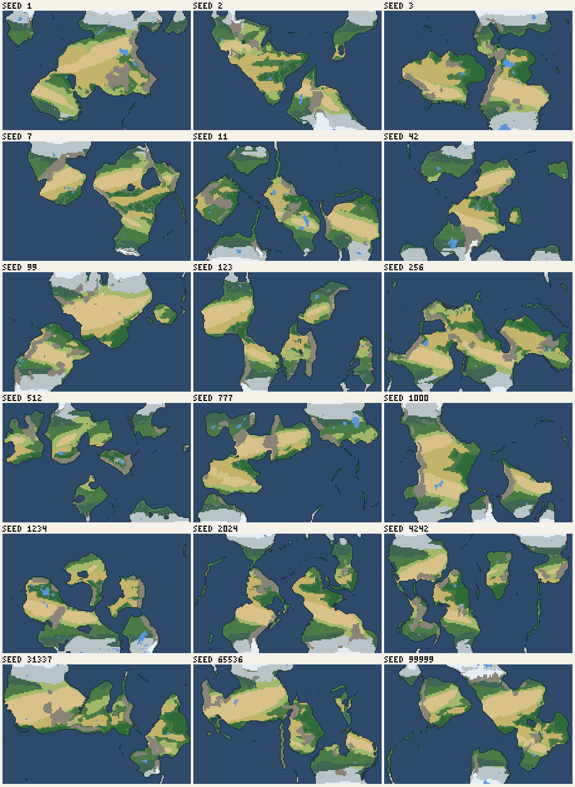

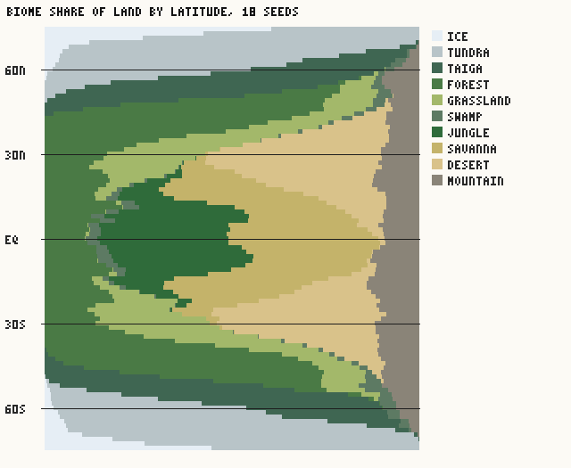
