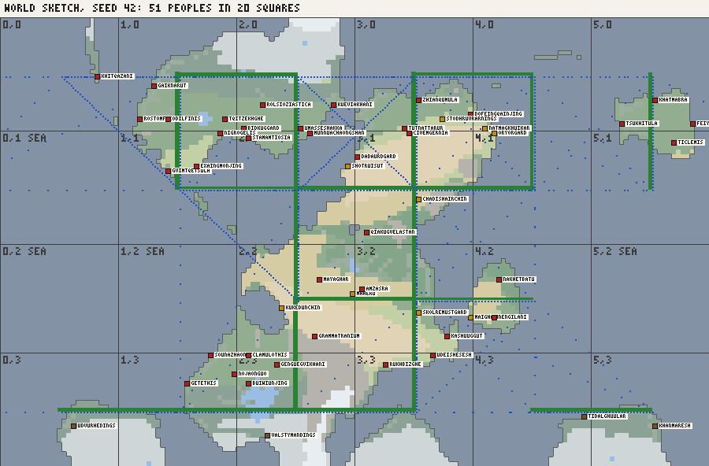

# The world sketch: design

2026-10-26. A design to agree on before building. It follows the decision in
`docs/WORLDGEN_SCALE.md`: one chronicle of the whole world, told at two levels, with a coarse
world sketch made at load and a region's detailed history made when the region is opened.

## What the sketch is for

A cheap plan of the whole world's history, made once per seed in well under a second, that every
region later follows. It decides:

- who lives where at the start
- how far each part of the world gets over time
- every contact between regions, with a date and a rough outcome

It does not decide anything inside a region: provinces, towns, rulers and battles stay the
region history's job.

## The grid

- The planet (150 x 95 cells) is cut into **6 x 4 squares** of 25 x 24 cells (the last row has
  23 cells). At the equator a square is about 6,700 x 4,200 km; at 50° about 4,300 x 4,200 km.
  That is the scale of Europe and the Mediterranean, as in the mock-up.
- Later, a region is a square regenerated at **5 x** the detail: 125 x 120 cells of ~53 km. That
  is about today's cell count, so a region's history takes as long as today's whole map.
  (7 x would double it.)
- Squares wrap east-west like the planet. A square with under 4% land is **open sea**: nobody
  lives there, but ships cross it.

## What the sketch holds

`world.sketch`, made by `AEON.makeSketch(world)` at the end of `createWorld`:

- **squares:** `{ id: "c,r", bounds, land, habitable, biomes, coast, river, mountains }`, the
  share of each biome and how much good land, coast and river floodplain it has.
- **links** between squares:
  - **land**, if two neighbouring squares share land across their border (how wide the
    crossing is, how passable: mountains, desert)
  - **sea**, if ships can get from one coast to the other over open water (the shortest sea
    lane in cells, and whether it hugs coasts or crosses open ocean)
- **peoples at the start**, 1-4 per square by its habitable land:
  `{ id, name, adjective, culture, archetype, square, seat, kind }`. They are named with the
  pack's own namer and cultures, and the archetype comes from the land: steppe nomads where
  grassland dominates, sea peoples on long coasts, river kingdoms on floodplains. In fantasy,
  each people's biome (dwarves in mountains, elves in forest) where the pack says so. These are
  the "predetermined kingdoms" Daan asked for; a region's history starts from them.
- **curves** per square, one value a century:
  - **development:** how far it has come
  - **age:** which of the pack's five ages it is in, and since when
  - **power:** development x people x cohesion

  Development grows fastest on floodplains and good farmland, and spreads along links:
  knowledge travels. Sometimes a dark age knocks it back.
- **contacts**, the timeline: `{ year, kind, from, to, by, outcome, strength }`.

  | Kind | When |
  |---|---|
  | trade | two linked squares are both developed enough |
  | migration | nomads or a crowded square move into a weaker neighbour by land |
  | raid, invasion | power at least ~2x the target, by land or by sea within the attacker's sea reach |
  | colonisation | by sea, with a development gap of 1.5 ages or more |

  Outcomes: repelled, raided, foothold (a coastal or border strip), conquest of part, conquest
  of all. Every contact feeds back into the curves: conquest moves power and spreads
  development, and a conquered square gets the newcomers as a people.
- **Sea reach by age:**

  | Age | Sea crossing |
  |---|---|
  | I | coasting only, about 6 cells |
  | II | 15 cells |
  | III | 40 cells |
  | IV | any sea, so oceans can be crossed |
  | V | any sea |

  So far-shore invasions (Daan's "Indians and Europeans") come late, and from the more
  developed side.
- **story:** one short line per contact, for the world chronicle
  ("In 1480 the Varnish fleets reached the eastern shores of the Ombra lands").

## Determinism

The sketch has its own random stream, `AEON.RNG(seed + ":sketch")`, so making it does not
change today's histories. It reads only the terrain. A region will read only the sketch (and
its own seed, `seed + ":" + squareId`), never another region, so any visiting order tells the
same story and every link reproduces.

## How a region will use it (a later step, not this one)

- Its starting realms are the sketch's peoples in that square, at their seats.
- An incoming contact becomes a dated event at the edge or coast facing the source: nomads
  riding in, a fleet landing, a colony founded. The region's history decides how far the
  newcomers get, within the outcome the sketch set.
- An outgoing contact becomes an expedition entry ("the fleet sailed west").
- The square's age curve guides the region's technology pace, so the region reaches the ages
  near when the sketch says.

## Building it, one step at a time (histories unchanged until regions exist)

1. **Grid, squares, links, peoples.** `js/sketch.js`, rendered by the harness: the grid over
   the biome map, peoples' seats and names, land and sea links. Check: same-seed histories
   identical before and after.
2. **Curves and contacts.** The century-by-century simulation and the timeline. The harness
   renders contact arrows by kind, development per square over time, and a text timeline. Check
   on 18 seeds:
   - how many contacts and of which kinds
   - when the first ocean crossing happens
   - that no square stays untouched for 4,500 years or is conquered every century
3. **See it in the app (view only).** A "World" map mode with the grid, the peoples and the
   contacts up to the shown year, plus a world timeline in the chronicle.

Then the region prototype (`WORLDGEN_SCALE.md`).

## Questions for Daan

- **Grid size:** 6 x 4 (24 squares, Europe-sized regions) as proposed, or 8 x 5 (40 smaller
  ones)?
- **Peoples per square:** 1-4 as proposed, or more?
- **Today's whole-planet history in the meantime:** should it already start from the sketch's
  peoples? I'd say no, until regions exist, so that steps 1-3 leave histories unchanged.
- **Pace:** should the sketch's timeline be eventful (dozens of contacts per world), or sparse
  (a handful of great migrations and invasions per world)?

## Progress

### Step 1, grid, squares, links, peoples (2026-10-26, histories unchanged)

`js/sketch.js`, `AEON.makeSketch(world)`, called at the end of `createWorld` (loaded after
`worldgen.js` in `index.html`). `world.sketch` = `{ cols: 6, rows: 4, squares, links, peoples }`:

- **squares:** `{ id: "c,r", x0, x1, y0, y1, cells, land, habitable, coast, river, mountains,
  biomes (shares), openSea, peoples (ids) }`. Under 4% land is open sea.
- **links:** `{ a, b, kind: "land" | "sea", width, rough, lane }`.
  - Land: `width` counts the land cells facing each other across the border, `rough` the share
    of them that are mountain or ice.
  - Sea: `lane` is the shortest lane in cells over open water from one square's coast to the
    other's, recorded up to 120 cells.
- **peoples:** `{ id, name, adjective, culture, archetype, square, seat, cells, kind }`, with 1-4
  per square by its habitable land.
  - **Seats:** the best sites (river x1.3, coast x1.1), at least 6 cells apart; each people
    holds the square's land nearest its seat.
  - **Archetype:** weighted by the land. A pack archetype's `ground` biomes filling its area
    add up to x7, a sea-going archetype (navy >= 1.5) on a long coast up to x7, a river seat
    x2.2 for river archetypes. Successor states are left out at the start.
  - **Names:** the pack's own namer.
  - **Kind:** nomads (grassland archetype on mostly its ground), kingdom (seat habitability
    0.55+) or tribes.

Checked: same-seed histories identical with and without the sketch (historical and fantasy,
seeds 7 and 42, chronicle and owner log hashed). 18 seeds (historical): 47-66 peoples (median
55) in 16-21 lived squares, 3-8 open-sea squares, 21-29 land links, 17-40 sea links of 6 cells or
less and 44-97 of 40 or less. All seven seeding archetypes appear in every world. Nearly every
people is a "kingdom", since seats take the best land; development (step 2) should decide
kingdom versus tribes instead. The harness draws `tools/out/sketch-<seed>.png`.

*Seed 42: squares with their ids, peoples' seats (red kingdom, ochre nomads, brown tribes),
land links (green, thicker for a wider border) and sea links (blue: solid up to 6 cells, dashed
up to 15, dotted up to 40).*
